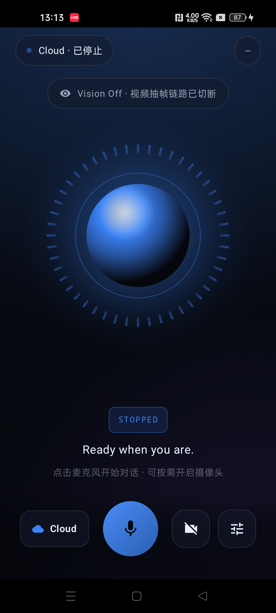
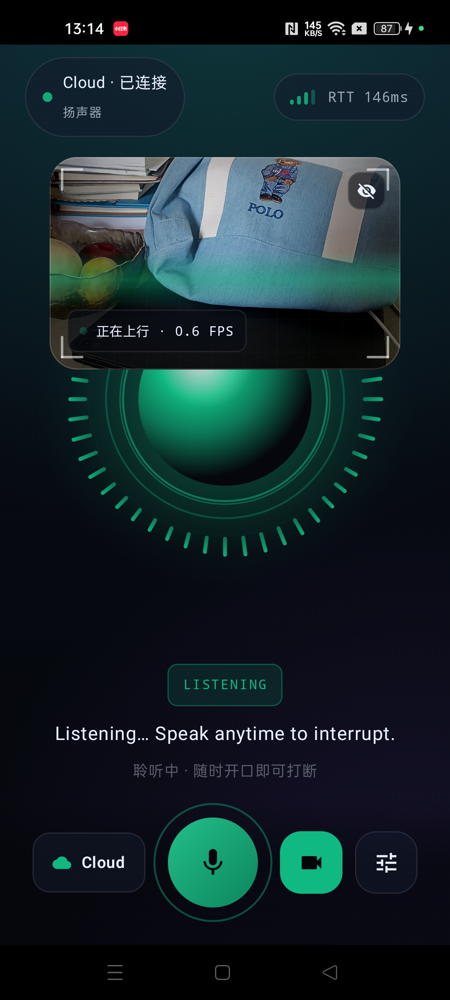
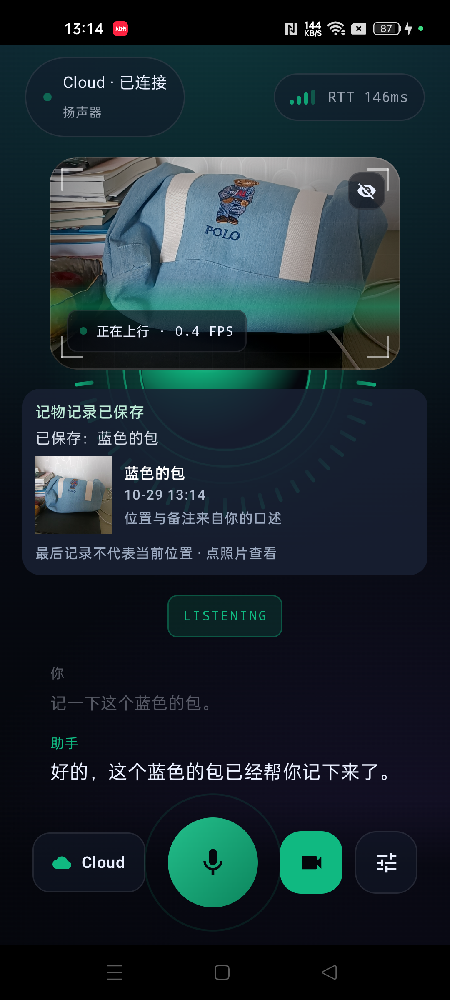
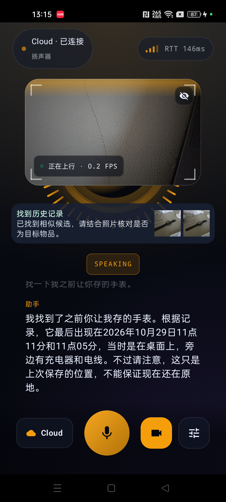
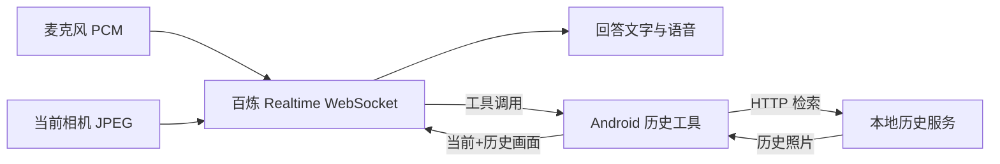

# EdgeVoiceAgent

面向“日常找东西、生活回忆”的 Android 实时语音与视觉助手。打开麦克风后，可以与阿里云百炼 Realtime 实时对话；打开相机后，可以就**当前画面**提问。App 显示用户转写和流式回答文字，并播放回答语音。可选的“历史画面”功能只保存用户明确要求记住的照片，再通过工具检索供同一个 Realtime 会话比较。

**第一次运行请先完成下面的 A（实时对话）；确认成功后再做 B（历史画面）。** A 不需要 Python 服务。先从[GitHub 仓库](https://github.com/jjjsyjiao/EdgeVoiceAgent)克隆或下载源码，进入包含 `settings.gradle.kts` 的目录。本文命令以 macOS/Linux 终端为例，均在这个项目根目录执行；Windows 用户可先用 Android Studio 完成 A。

| 当前能用 | 当前边界 |
| --- | --- |
| Cloud 模式的语音问答、相机画面问答、文字与语音回答、最近 5 轮对话滚动查看 | Local 按钮尚未开放语音对话；不能靠下载本地模型绕过云端 API Key |
| 明确说“记一下/保存一下”后保存照片、跨会话查找、点开证据照片 | 不会因打开相机就连续录制或自动保存画面；本地历史服务依赖电脑和 ADB 连接 |
| 可选图文向量＋关键词混合检索与重排 | 真实生活照片的召回率尚未测定；候选照片及位置仍需核对，不能当成确定事实 |

## 真机运行示意

点击图片可查看原图。四张截图依次展示待机、实时相机问答、主动保存物品、检索历史并语音回答。

<table>
  <tr>
    <td align="center"><a href="docs/screenshots/01-ready.png"></a><br />待机界面</td>
    <td align="center"><a href="docs/screenshots/02-live-camera.png"></a><br />实时相机画面</td>
  </tr>
  <tr>
    <td align="center"><a href="docs/screenshots/03-saved-item.png"></a><br />主动保存物品</td>
    <td align="center"><a href="docs/screenshots/04-history-answer.png"></a><br />历史检索与回答</td>
  </tr>
</table>

图中的照片由用户主动保存；历史候选和上次记录的位置不代表物品现在的位置。

## A. 先跑通实时语音和相机

### 1. 准备环境

- Android Studio 打开本目录，安装 **Android SDK Platform 34**、**SDK Platform-Tools**、**NDK 28.2.13676358** 和 **CMake 3.22.1**。项目用 Gradle Wrapper 8.5，无需另装 Gradle；Gradle JDK 使用 17 或 21。若终端提示 `adb: command not found`，在 Android Studio 的 SDK Manager 查看 SDK 路径，将其中的 `platform-tools` 目录加入 PATH，或用 `<SDK路径>/platform-tools/adb` 替换下文的 `adb`。
- 一部 Android 8.0（API 26）及以上、有麦克风的手机；相机问答需有相机。模拟器可以用于构建和基本界面检查，真实摄像头与音频体验建议用真机。
- 已开通可用的[阿里云百炼](https://bailian.console.aliyun.com/) API Key，手机能够访问百炼服务。调用云模型可能产生费用。

### 2. 配置项目

用 Android Studio 打开项目后，在根目录**编辑已有的** `local.properties`；如果没有该文件则新建。Android Studio 通常会写入 Android SDK 的 `sdk.dir`，不要删除这一行。手动用命令行构建时，若没有配置 `ANDROID_HOME`，还需写入自己的 SDK 绝对路径，例如 macOS 的 `sdk.dir=/Users/你的用户名/Library/Android/sdk`。

在 `local.properties` 中加入以下配置，把示例 Key 换成自己的真实值：

```properties
realtime.provider=qwen
openai.api.key=sk-在这里填百炼API-Key
openai.realtime.url=wss://dashscope.aliyuncs.com/api-ws/v1/realtime
openai.realtime.model=qwen3.5-omni-flash-realtime
vision.uplink=true
history.enabled=false
session.frame.enabled=false
```

`openai.*` 是项目沿用的配置键名；`realtime.provider=qwen` 时这里填写的是**百炼** Key、URL 和模型。已验证的上述通用 WebSocket 地址不需要 `QWEN_WORKSPACE_ID`；有专属业务空间地址时才按实际服务要求替换 URL。`local.properties` 已被 `.gitignore` 排除，但 Key 会编入开发 APK，**不要把这个 APK 公开分发**。

### 3. 构建、安装、第一次提问

先在手机上开启 USB 调试、连接电脑，并在手机上允许这台电脑调试。然后执行：

```bash
adb devices                         # 应看到一行状态为 device 的手机
./gradlew :app:assembleDebug         # 成功后生成 app/build/outputs/apk/debug/app-debug.apk
./gradlew :app:installDebug          # 安装到已连接的手机
```

也可以在 Android Studio 选择手机，点击 **Run 'app'**。若连接多台设备，使用 `adb -s 设备序列号 install -r app/build/outputs/apk/debug/app-debug.apk` 指定目标。修改 `local.properties` 后须**重新构建并安装**，旧 APK 不会自动更新配置。

打开 App（默认是 **Cloud**），点击底部麦克风并授予录音权限，说“一加一等于几”。成功时会看到“你”的转写、逐步出现的助手回答，并听到完整语音。再点击右侧相机图标、授予相机权限，对准物品提问“这是什么？”；相机只预览时不会自动把画面发给模型，需同时保持麦克风会话。再次点击麦克风可停止会话；退到后台或锁屏也会停止，返回后需要手动开始。

到这里，**实时语音＋当前画面链路就已跑通**，无需启动 `server/`。

## B. 再启用历史画面保存与检索（本地开发）

本地历史服务运行在电脑上，照片和元数据保存在 `server/data/visual-memory-local/`（已忽略，不入版本库）。手机通过 `adb reverse` 访问电脑的 `127.0.0.1:8000`。USB 调试或无线 ADB 均可，但手机与电脑的 ADB 连接必须持续存在；断开后历史功能会不可用。首次用无线 ADB 时，需先在手机“无线调试”和 Android Studio 中完成配对与连接，直到 `adb devices` 显示 `device`；下面的脚本只负责保持已配对设备的连接。此流程适用于 **Debug APK**，独立使用需要部署 HTTPS 服务。

### 1. 安装 Python 服务依赖

需要 Python **3.11 或更新版本**。先运行 `python3 --version`；macOS 系统自带 `python3` 可能是 3.9，此时改用已安装的 `python3.11`、`python3.12` 或 `python3.13` 创建虚拟环境。例如：

```bash
python3.13 -m venv server/.venv      # 把 python3.13 换成你机器上实际的 3.11+ 命令
server/.venv/bin/python -m pip install -r server/requirements.txt
```

首次安装依赖可能较慢。脚本默认用 hashing 运行旧文本偏好服务，不下载神经模型；**新历史画面**是否调用百炼图文检索模型由 B-3 的开关决定。`server/requirements.txt` 包含历史 JPEG 校验所需的 Pillow；不要照旧文档只手工安装 FastAPI 等少数包。

### 2. 配置历史功能

继续在同一个根目录 `local.properties` 中，将 `history.enabled=false` 改成 `true`，并加入：

```properties
history.enabled=true
history.endpoint=http://127.0.0.1:8000
history.api.token=在这里填一串至少16字符的随机令牌
history.time.zone=Asia/Shanghai
history.retrieval.enabled=false
```

可以用 `server/.venv/bin/python -c 'import secrets; print(secrets.token_urlsafe(32))'` 生成令牌，复制输出替换示例值。不要把令牌写入 README 或提交到版本库。`history.retrieval.enabled=false` 是最容易验证的**名称/别名/备注检索基线**；即使不开图文向量，保存和按名称查询也能工作。历史服务脚本会从同一个 `local.properties` 读取令牌，自动映射到服务端用户，不需要另设环境变量。

### 3. 启动服务、保持连接、重新安装 App

先确认 `adb devices` 能看到目标手机。用设备列表第一列的真实序列号替换下面的 `设备序列号`，在**单独一个终端**运行：

```bash
server/.venv/bin/python tools/history_dev_link.py --serial 设备序列号
```

看到“服务 metadata；……历史连接已就绪”后，保持此终端运行。它会启动本地服务、建立并维持 `adb reverse tcp:8000 tcp:8000`，无线 ADB 短暂断开时也会尝试重连。若服务已由别的进程占用 8000 端口，脚本会检查令牌是否匹配；不匹配时先停止旧服务。另开一个终端，仍在项目根目录，重新构建并安装：

```bash
./gradlew :app:assembleDebug
./gradlew :app:installDebug
```

打开 App，开启相机和麦克风，对准手表说“记一下这个手表”。出现“请确认是否保存”时先看照片，点“确认保存”；若直接显示“记物记录已保存”也表示服务端已确认写入。随后问“我上次保存的手表是哪张照片？”，应看到历史证据卡，并得到文字和语音回答。要比较当前与历史，继续对准物品问“这个和上次记的手表是同一个吗？”。历史候选是**待核对证据**，不是物品身份的最终判定。

### 4. 可选：开启图文混合检索

按名称查询跑通后，如需用图片内容、近义说法提高候选召回，在 `local.properties` 中改为：

```properties
history.retrieval.enabled=true
history.retrieval.embedding.model=qwen3-vl-embedding
history.retrieval.embedding.dimension=2560
history.retrieval.rerank.enabled=true
history.retrieval.rerank.model=qwen3-vl-rerank
```

重启 `history_dev_link.py`；客户端开关未变时无需重新安装 App。脚本默认复用 `openai.api.key` 调用百炼的**独立 HTTPS 图文嵌入/重排接口**；也可单独设置 `history.retrieval.api.key`。这些调用可能收费，索引需等待就绪。终端显示 `服务 hybrid` 和索引状态。它们只负责找候选照片；当前与历史画面的最终比较、文字和语音回答仍在原 Realtime 会话中完成。模型接口与检索细节见[服务端说明](server/README.md)。

历史画面默认保留 **7 天**，每个用户照片最多 **128 MiB**，全服务最多 **512 MiB**，达到容量限制会提前淘汰旧照片。可在 `local.properties` 中设置 `history.retention.days=30` 等本地试用保留期，重启服务生效。当前是单机 SQLite 元数据＋JPEG 文件；向量索引也在本地 SQLite 中，不是无限容量的外部向量数据库。

## 常见问题

| 现象 | 先检查什么 |
| --- | --- |
| `SDK location not found`、NDK/CMake 缺失 | 用 Android Studio 的 SDK Manager 安装上述版本；检查根目录 `local.properties` 的 `sdk.dir`。 |
| `adb devices` 无设备或显示 `unauthorized` | 解锁手机、允许 USB 调试；无线调试时先完成配对/连接。重新连接后等待设备状态变为 `device`。 |
| App 提示没有云端配置、连接失败或没有回答 | 确认 Key、模型与 `wss://` URL，手机联网，选 Cloud；改配置后重新构建安装。 |
| 只看到相机预览，模型没有看图 | 保持麦克风会话运行，确认 `vision.uplink=true`、相机权限已给，使用 Qwen 配置。 |
| “历史操作未完成”或找不到已存照片 | 确认 B 的服务终端仍显示连接就绪、`history.enabled=true` 已编入新 APK、手机 ADB 仍在线；重新连接后让脚本恢复端口转发。 |
| 保存成功但查不到 | 先用记录时的名称查询；`metadata` 模式不能只靠图片内容搜索。检查是否超过保留期或容量上限。`hybrid` 模式还要等待索引就绪。 |
| Python 服务报 `ModuleNotFoundError: PIL` | 用 B-1 的 `-r server/requirements.txt` 在正确虚拟环境里安装，确认 Python 为 3.11+。 |

## 验证与继续阅读

文档修改不需要云模型调用。代码自测命令如下：

```bash
./gradlew testDebugUnitTest :app:assembleDebug :app:lintDebug
server/.venv/bin/python -m pip install pytest    # 首次运行服务端测试才需要
(cd server && .venv/bin/python -m pytest tests -q)
```

- [必要链路验收](必要链路验收.md)：语音/相机的真机验收边界与平台烟测。
- [日用版本实施与验收](日用版本实施与验收.md)：打断、重连、权限和前后台行为。
- [历史工具接入实施与验收](历史工具接入实施与验收.md)：工具协议、当前/历史画面的同模型比较。
- [服务端说明](server/README.md)与[图文检索评测](server/evals/visual_retrieval/README.md)：存储、索引、接口和真实召回率评测方式。
- [产品方案](日常找物与生活回忆-MVP产品方案.md)：后续功能规划。

代码入口：`app/` 是 Android 页面与装配，`core-media/` 负责麦克风/相机，`core-transport/` 负责 WebSocket，`core-executor/` 负责 Realtime 事件，`sdk-core/` 负责会话、历史工具与编排，`ui-presentation/` 负责 Compose 页面，`server/` 是独立 Python 进程。关键链路如下：



`memory.endpoint`、`session.frame.*` 和旧 V2/V3 自动留帧是早期实验链路，不是当前“历史画面”入门流程；不要用它们代替 `history.*`。公开分发前还需把长期云 API Key 从 APK 移到受控授权服务，并部署可独立访问的 HTTPS 历史服务。
